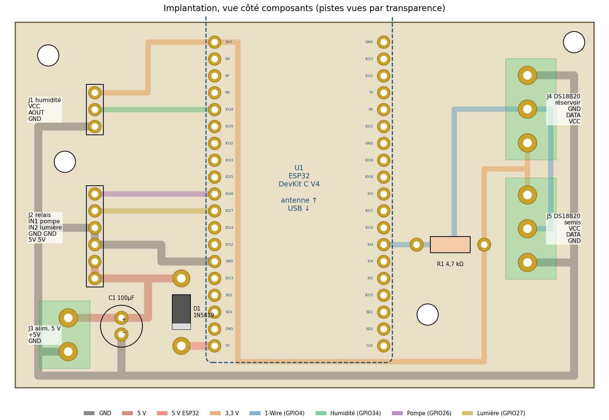
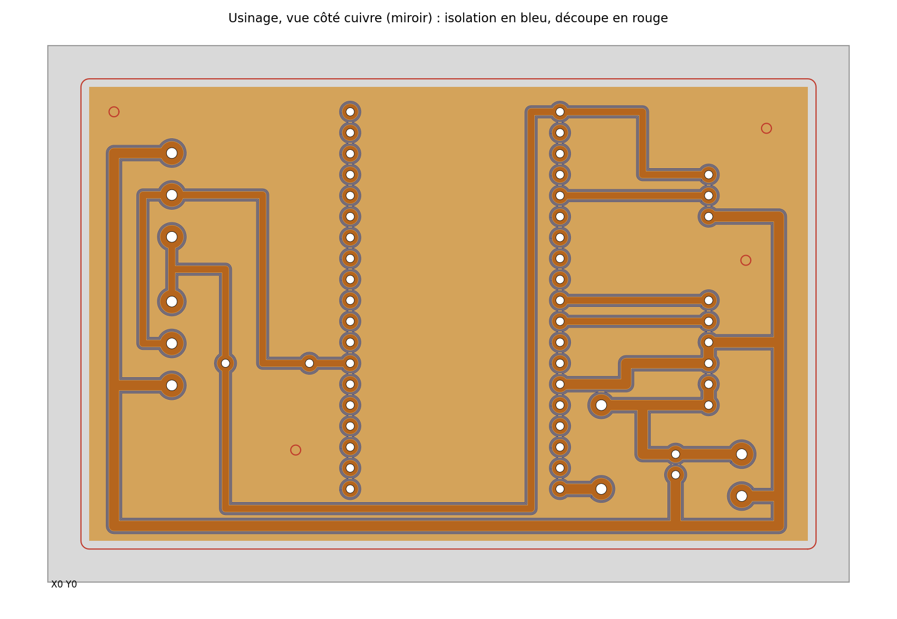

# SemX — circuit imprimé

Carte simple face de 87 × 55 mm, à graver à la CNC. Elle reçoit l'ESP32 DevKit C V4 sur deux barrettes femelles et relie les deux sondes DS18B20, le capteur d'humidité du sol, les deux relais et l'alimentation 5 V, suivant le [brochage](../V1/README.md#brochage). L'antenne de l'ESP32 dépasse du bord haut, et le connecteur USB reste accessible en bas.

Tout le dossier est produit par un seul script Python, [`pcb_semx.py`](pcb_semx.py) : la carte y est décrite en coordonnées, et le script en tire les fichiers de fabrication et les images.

## Contenu du dossier

| Chemin | Contenu |
|---|---|
| [`pcb_semx.py`](pcb_semx.py) | Script paramétrique : description de la carte, contrôle des réseaux, génération des fichiers |
| [`fabrication/gerber/`](fabrication/gerber/) | `SemX-B_Cu.gbl` (cuivre, face dessous, vu de dessus), `SemX-Edge_Cuts.gm1` (contour) et `SemX.drl` (perçage Excellon), pour FlatCAM, KiCad ou un autre logiciel de FAO |
| [`fabrication/gcode/`](fabrication/gcode/) | G-code GRBL prêt à l'emploi, déjà mis en miroir pour être usiné côté cuivre |
| [`images/`](images/) | Plan d'implantation et aperçu des trajectoires d'usinage |

## Implantation



| Repère | Composant | Raccordement |
|---|---|---|
| U1 | ESP32 AZ-Delivery DevKit C V4, sur 2 barrettes femelles 1 × 19 au pas de 2,54 mm | — |
| J1 | Barrette mâle 1 × 3 | Capteur d'humidité : VCC (3V3), AOUT (GPIO34), GND |
| J2 | Barrette mâle 1 × 6 | Relais : IN1 pompe (GPIO26), IN2 lumière (GPIO27), GND, GND, 5V, 5V |
| J3 | Bornier à vis 2 points, pas de 5,08 mm | Alimentation 5 V : +5V, GND |
| J4, J5 | Bornier à vis 3 points, pas de 5,08 mm | DS18B20 réservoir et semis : VCC (3V3), DATA (GPIO4), GND |
| R1 | Résistance 4,7 kΩ 1/4 W | Tirage du bus 1-Wire vers le 3V3 |
| C1 | Condensateur 100 µF 10 V radial, pas de 2,5 mm (facultatif) | Découplage du 5 V |
| D1 | Diode Schottky 1N5819 (1 A, boîtier DO-41), bague vers l'ESP32 | Du bornier 5 V vers la broche 5V de l'ESP32 |

Espacements et perçages, pour vérifier les composants avant d'usiner :

| Repère | Broches | Pas entre broches | Perçage | Pastille de cuivre |
|---|---|---|---|---|
| U1 ESP32 | 2 rangées de 19 | 2,54 mm, rangées espacées de 25,4 mm d'axe en axe | 1,0 mm | 1,9 mm |
| J1 humidité | 1 × 3 | 2,54 mm | 1,0 mm | 1,9 mm |
| J2 relais | 1 × 6 | 2,54 mm | 1,0 mm | 1,9 mm |
| J3 alimentation | 2 | 5,08 mm | 1,3 mm | 2,8 mm |
| J4, J5 DS18B20 | 3 | 5,08 mm | 1,3 mm | 2,8 mm |
| R1 | 2 | 10,16 mm | 1,0 mm | 2,0 mm |
| C1 | 2 | 2,5 mm | 1,0 mm | 2,0 mm |
| D1 | 2 | 10,16 mm | 1,3 mm | 2,6 mm |
| Fixations | 4 trous M3 | Centres à (5 ; 50), (84 ; 52), (7,5 ; 34) et (62 ; 11) mm du coin bas gauche, vue côté composants | 3,2 mm, fraisé | Aucune |

Pistes de 0,8 mm pour les signaux et de 1,2 mm pour l'alimentation, avec au moins 0,4 mm entre deux réseaux.

## Usinage



Les fichiers de [`fabrication/gcode/`](fabrication/gcode/) se lancent dans l'ordre :

1. `1_isolation_fraiseV.nc` : fraise en V (30°, pointe 0,1 mm), 0,1 mm de profondeur, 3 passes ;
2. `2_percage_1.0mm.nc` et `3_percage_1.3mm.nc` : forets de 1,0 et 1,3 mm ;
3. `4_detourage_fraise2mm.nc` : fraise droite de 2 mm, trous de fixation M3 puis contour avec 4 attaches.

- Plaque FR1 ou FR4 simple face d'au moins 97 × 65 mm, cuivre vers le haut. L'origine X0 Y0 est le coin avant gauche de la plaque, la carte commençant 5 mm plus loin ; Z0 est la surface du cuivre.
- Refaire le zéro Z à chaque changement d'outil, sans toucher à X et Y. Un relevé de planéité (autolevelling, par exemple dans Candle) est fortement conseillé pour l'isolation.
- Avant d'usiner, mesurer l'entraxe des deux rangées de broches de l'ESP32 : la carte suppose 25,4 mm (`ESP_ROW_SPACING` dans le script).

## Montage

Composants côté sans cuivre, soudures côté cuivre.

L'USB de l'ESP32 peut rester branché pendant que la carte est alimentée par le bornier. D1 empêche le 5 V du bornier de remonter vers l'USB, et la diode que le DevKit C V4 place sur son USB empêche l'inverse : l'ESP32 prend la plus haute des deux tensions. Les relais restent alimentés directement par le bornier : avec l'USB seul, l'ESP32 fonctionne mais les relais ne commutent pas. La chute de tension de D1 laisse environ 4,6 V sur la broche 5V, ce qui suffit au régulateur 3,3 V de l'ESP32. Sur une copie du DevKit d'un autre fabricant, vérifier la présence de la diode USB avant de brancher les deux sources.

## Régénérer les fichiers

```bash
pip install shapely matplotlib
```

```bash
python PCB/pcb_semx.py
```

Le script vérifie d'abord la continuité de chaque réseau et l'écart minimal entre réseaux, et affiche le résultat. Il réécrit ensuite tout le contenu de `fabrication/` et les deux images de `images/`.

Principaux réglages, en tête du script :

| Réglage | Valeur | Rôle |
|---|---|---|
| `W`, `H` | 87 × 55 mm | Dimensions de la carte |
| `ESP_ROW_SPACING` | 25,4 mm | Entraxe des deux rangées de broches de l'ESP32 |
| `TRACE_SIGNAL`, `TRACE_POWER` | 0,8 / 1,2 mm | Largeur des pistes de signal et d'alimentation |
| `MIN_CLEARANCE` | 0,4 mm | Écart minimal exigé entre deux réseaux |
| `MOUNT_HOLES` | 4 positions | Centres des trous de fixation M3 |
| `OFFSET` | 5 mm | Marge entre le coin de la plaque (origine machine) et la carte |
| `ISO_DEPTH`, `ISO_PASSES` | −0,1 mm, 3 passes | Profondeur et nombre de passes de l'isolation |
| `DRILL_DEPTH` | −1,9 mm | Profondeur de perçage |
| `CUT_TOOL`, `CUT_DEPTH`, `CUT_STEP` | 2 mm, −1,8 mm, 0,45 mm | Fraise, profondeur et passe du détourage |
| `TAB_WIDTH`, `TAB_Z` | 3 mm, −1,0 mm | Largeur et hauteur des attaches du contour |
| `SPINDLE` | 10 000 tr/min | Vitesse de la broche |
