# SemiX

SemiX est un projet de chambre de culture destiné à accompagner la germination et les premières étapes de croissance des semis. L’objectif est de réunir dans un espace contrôlé les conditions dont les jeunes plants ont besoin, et de rendre leur suivi plus régulier qu’avec une installation entièrement manuelle.

## Objectifs

La chambre de culture vise à agir sur plusieurs paramètres importants pour le développement des semis :

- **L’éclairage** : fournir une durée et une période d’éclairage adaptées aux besoins des plants.
- **L’arrosage** : apporter de l’eau de manière maîtrisée afin de maintenir un substrat suffisamment humide, sans l’inonder.
- **La température** : suivre et réguler la température de l’espace de culture pour limiter les variations défavorables à la germination.
- **La chaleur** : prévoir une source de chaleur si nécessaire, pilotée en fonction des conditions mesurées.
- **L’humidité** : surveiller l’humidité de l’air et, selon la conception retenue, contribuer à la maintenir dans une plage appropriée.

## Éléments techniques

### Contrôleur

- **ESP32** : microcontrôleur chargé de piloter l’ensemble du système (lecture des capteurs et commande des actionneurs).

### Capteurs

- **Sonde de température DS18B20 (réservoir)** : mesure la température de l’eau du réservoir.
- **Sonde de température DS18B20 (semis)** : mesure la température au niveau du semis.
- **Capteur d’humidité du sol (moisture sensor)** : mesure l’humidité du substrat des semis.

### Actionneurs

- **Relais pompe** : allume et éteint la pompe à eau.
- **Relais éclairage** : simule un appui de 1 s sur le bouton marche / arrêt des lampes LED pour les allumer ou les éteindre.

### Brochage

| Élément | Broche signal | Alimentation | Remarque |
|---|---|---|---|
| DS18B20 réservoir | GPIO4 | 3V3 / GND | Bus 1-Wire partagé |
| DS18B20 semis | GPIO4 | 3V3 / GND | Une seule résistance de 4,7 kΩ entre DATA et 3V3 pour tout le bus |
| Capteur d’humidité du sol | GPIO34 | 3V3 / GND | Modèle capacitif recommandé |
| Relais pompe | GPIO26 (IN) | 5V / GND | Pompe branchée sur COM/NO, avec sa propre alimentation |
| Relais éclairage | GPIO27 (IN) | 5V / GND | COM/NO en parallèle du bouton marche / arrêt des lampes |
| Alimentation 5 V | VIN / 5V de l’ESP32 | 220v | Toutes les masses (GND) reliées entre elles |

Remarques :

- GPIO34 et GPIO35 appartiennent à l’ADC1, qui reste utilisable lorsque le Wi-Fi est actif (contrairement à l’ADC2).
- GPIO4, GPIO26 et GPIO27 ne sont pas des broches de démarrage, ce qui évite un blocage au boot ou un déclenchement intempestif des relais.
- Les DS18B20 acceptent de 3,0 à 5,5 V. Si elles sont alimentées en 5 V, la résistance de tirage doit rester reliée au 3V3, car les GPIO de l’ESP32 ne tolèrent pas le 5 V.
- De nombreux modules relais sont actifs à l’état bas : vérifier la logique du module utilisé et sa compatibilité avec une commande en 3,3 V.

## Réservoir, bac et godets

Le bac de semis est posé sur le réservoir d'eau et reçoit 24 godets de semis et un godet de mesure. L'eau monte dans le bac et les godets l'absorbent par les trous de leur fond. Un trop-plein limite la hauteur d'eau dans le bac et renvoie le surplus dans le réservoir.

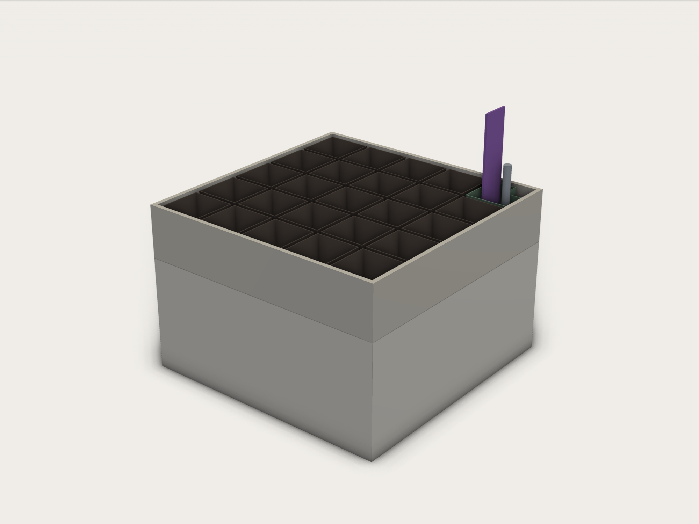

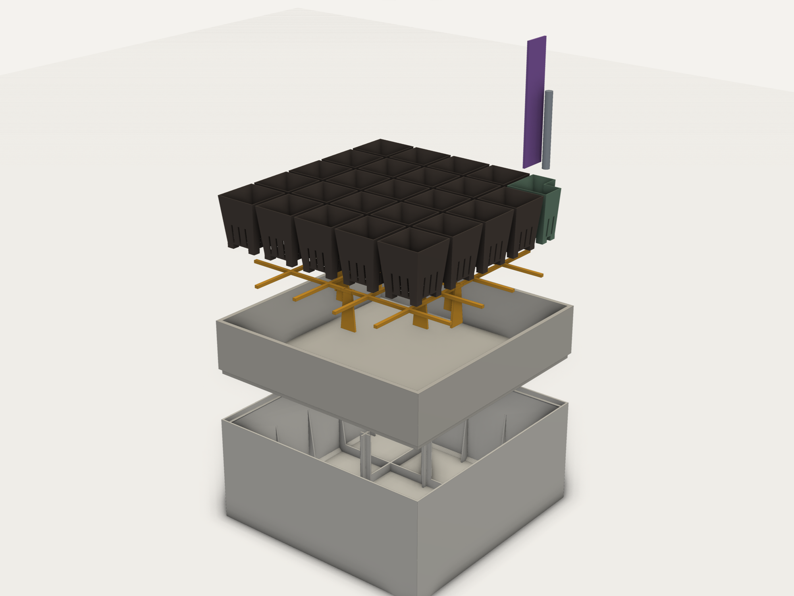

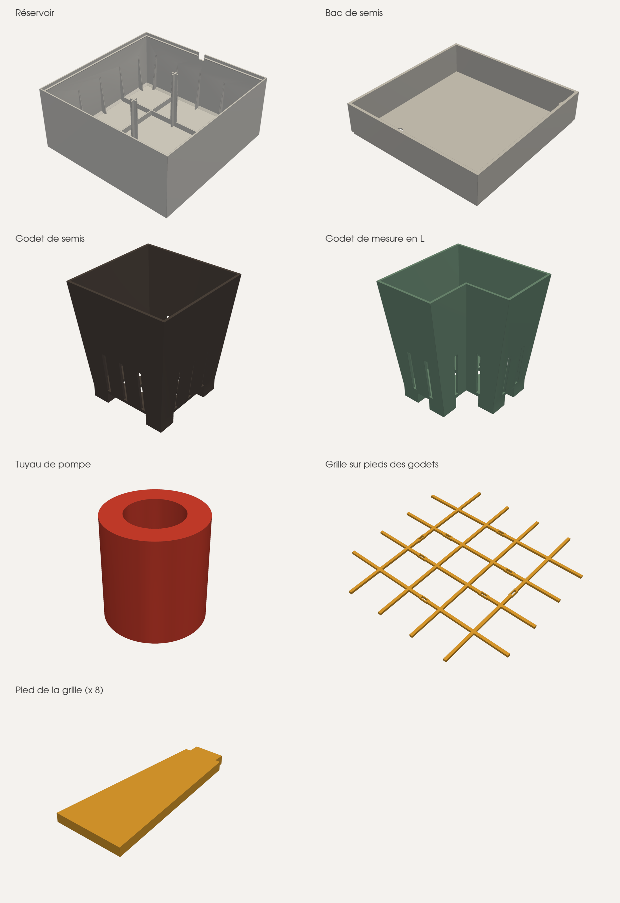

| Pièce (`STL/`) | Quantité | Dimensions | Description |
|---|---|---|---|
| `reservoir_201x201x90_2piliers_paroi2.0.stl` | 1 | 201 × 201 × 90 mm | Réservoir d'eau aux parois de 2 mm, raidies par des nervures triangulaires. Deux piliers en croix soutiennent le centre du bac, et une grille de nervures renforce le fond. Une encoche dans le bord laisse passer le câble de la pompe immergée. |
| `bac_semis_201x201x46_socle.stl` | 1 | 201 × 201 × 46 mm | Bac qui reçoit les godets. Son socle s'emboîte dans le haut du réservoir. Dans un coin, un trop-plein de Ø 14 mm (passage de Ø 10 mm) haut d'environ 25 mm renvoie l'eau en excès dans le réservoir. Un trou de Ø 8,4 mm au ras du fond, vers le coin opposé, reçoit l'eau envoyée par la pompe. |
| `godet_semis_36x36x42.stl` | 24 | 36 × 36 × 42 mm | Godet de semis évasé, de 28 × 28 mm au fond. Il repose sur 4 pieds de 6 mm, et ses 9 trous de 3 mm laissent l'eau entrer par le dessous. Les godets se placent sur une grille de 5 × 5 cases de 36 mm. |
| `godet_mesure_36x19x42.stl` | 1 | 36 × 19 × 42 mm | Demi-godet, avec le même substrat que les godets de semis, dans lequel plongent le capteur d'humidité et la sonde DS18B20 du semis. Il repose sur 4 pieds et a 5 trous de 3 mm au fond. |
| `couvercle_godet_mesure_36x19.stl` | 1 | 42 × 22 × 8 mm | Couvercle emboîté sur le godet de mesure, qui maintient les capteurs : une fente de 24 × 2,4 mm pour le capteur d'humidité capacitif et un trou de Ø 6,6 mm pour la sonde DS18B20. |
| `support_godet_mesure_36x19.stl` | 1 | 46 × 46 × 24 mm | Cadre posé dans la case d'angle du bac, à côté du trop-plein. Il cale le godet de mesure, et sa paroi en U entoure le trop-plein. |
| `grille_godets_pieds_193x193x2.stl` | 1 | 193 × 193 × 2,4 mm | Grille mince posée à mi-hauteur des godets, qui les empêche de basculer. Voir [Grille sur pieds](#grille-sur-pieds). |
| `grille_godets_pied_14x33.stl` | 8 | 14 × 33 × 1,8 mm | Pied plat de la grille, emboîté dans une fente par son tenon. |
| `Tuyau Pompe.stl` | 1 | Ø 14 × 15 mm | Manchon de Ø 14 mm, au passage de Ø 8 mm, collé sous le bac, dans l'axe du trou d'arrivée d'eau. Il tient le tuyau qui remonte de la pompe jusqu'à ce trou. |
| `assemblage_v12_vue.stl`, `assemblage_v12_eclate_vue.stl` | — | — | Vues d'assemblage, monté et éclaté, non destinées à l'impression. Elles représentent le capteur d'humidité et la sonde par de simples volumes, et montrent une ancienne version du couvercle, plate, sans le support du godet de mesure. |

### Grille sur pieds

Quand l'eau monte, le terreau sec contient trop d'air : un godet plein pèse 13 à 16 g, alors qu'il déplace jusqu'à 19 g d'eau au niveau du trop-plein. Il se soulève, puis bascule. La grille tient chaque godet droit dans sa case, quel que soit le nombre de godets dans le bac.

| Montée | Éclatée |
|---|---|
| 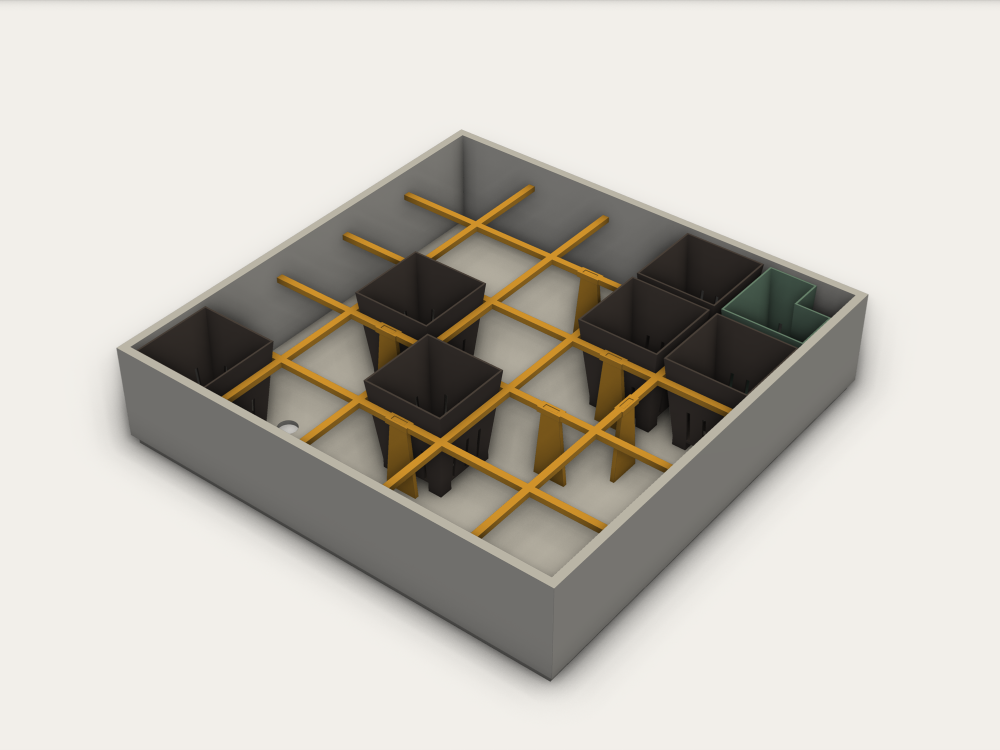 | 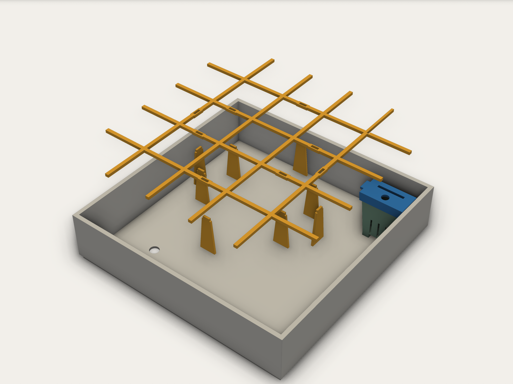 |

- **Grille** : des nervures de 3 × 2,4 mm, au pas de 39 mm, à 31 mm au-dessus du fond, donc 6 mm au-dessus du trop-plein. À cette hauteur, un godet mesure 34 mm : il garde environ 1 mm de jeu de chaque côté et ne peut pas s'incliner de plus de 2°. Le bout des nervures touche presque les parois et centre la grille dans le bac.
- **Pieds** : 8 lames plates, imprimées à part. Chacune se place entre deux godets, au milieu d'un côté de case, et s'emboîte par un tenon dans une fente de la grille. Les pieds évitent l'arrivée d'eau et le coin du godet de mesure. Comme les bouts des nervures bloquent la grille contre les parois, les pieds ne peuvent pas basculer.
- **Coin du godet de mesure** : la case d'angle reste libre. La grille passe au-dessus du support du godet de mesure, haut de 26 mm. La nervure qui longe le godet de mesure est amincie de son côté, pour accepter un décalage du godet jusqu'à 1,5 mm vers le centre.
- **Limite** : la grille empêche le basculement, pas la flottaison. Les godets sont évasés : un godet qui monte prend du jeu dans sa case. Il reste debout, puis redescend quand le terreau a bu. Humidifier le terreau avant de remplir les godets évite qu'ils se soulèvent.
- **Impression** : grille et 8 pieds tiennent sur un seul plateau, à plat, sans support. Avec Bambu Studio (X1 Carbon, buse 0,4, PETG HF, couches de 0,20 mm, 3 parois), comptez **33 min et 19 g**. Avec des pieds imprimés d'un bloc avec la grille, il faudrait 54 min : ces 150 couches presque vides seraient ralenties par le temps minimal de couche.

Montage : enfoncer les 8 pieds dans les fentes, poser la grille dans le bac, puis glisser chaque godet dans sa case. Le script [`CAD/grille_godets_pieds.py`](CAD/grille_godets_pieds.py) régénère les deux STL. Ses principaux réglages :

- `GRID_Z` : hauteur de la grille ;
- `RIB_T` : épaisseur des nervures, et donc le jeu des godets ;
- `SLOT_CLEAR` : serrage des tenons ;
- `FEET` : position des pieds.

Les images sont générées par `python CAD/rendu_pieces.py` (`pip install trimesh pyvista pillow scipy`).

## Support des panneaux LED

Support imprimable pour 4 panneaux LED de 80 × 300 mm, réglable en hauteur par crans de 30 mm. Deux pieds sont collés sur les faces gauche et droite du réservoir et portent chacun deux colonnes, espacées de la largeur de deux panneaux. Une traverse relie les deux colonnes de chaque face, ce qui empêche le support de se tordre. Les panneaux, épais de 1 mm, sont collés sous les traverses par leur face arrière, avec huit morceaux d'adhésif double face 3M de 30 × 50 mm. Deux entretoises relient les traverses par-dessus les panneaux. Les panneaux, orientés selon l'axe gauche-droite, passent à deux entre les colonnes et un de chaque côté, et les faces avant et arrière restent libres pour accéder aux semis ou sortir le bac.

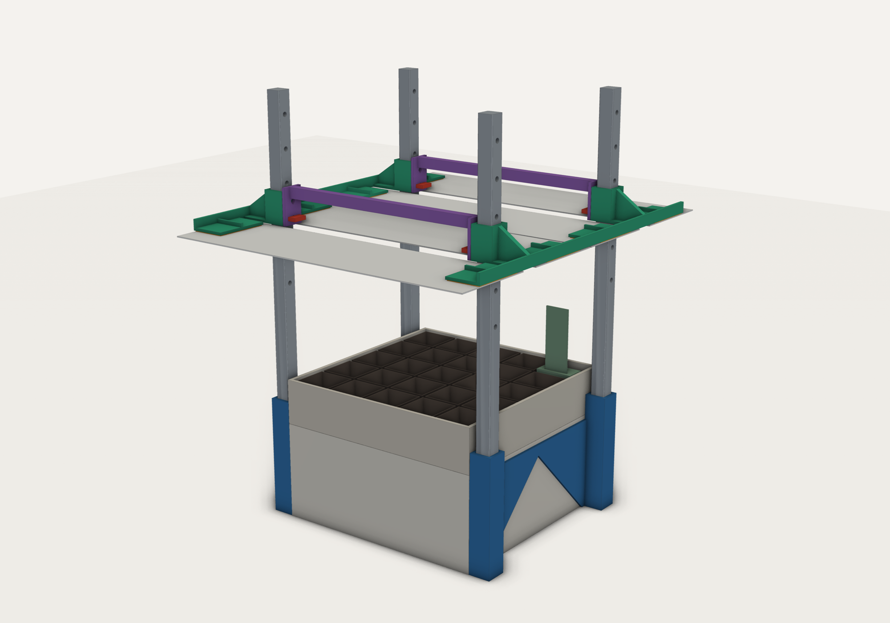

| Pièce (`STL/`) | Quantité | Masse unitaire | Impression |
|---|---|---|---|
| `support_led_pied.stl` | 2 | 72 g | Telle quelle, avec bordure (brim) |
| `support_led_colonne.stl` | 4 | 29 g | Telle quelle, en diagonale du plateau, remplissage 10 % |
| `support_led_traverse.stl` | 2 | 51 g | Telle quelle, en diagonale du plateau, bande de collage sur le plateau |
| `support_led_entretoise.stl` | 2 | 13 g | Telle quelle, corps sur le plateau, pattes vers le haut |
| `support_led_goupille.stl` | 4 + rechange | 0,8 g | À plat |

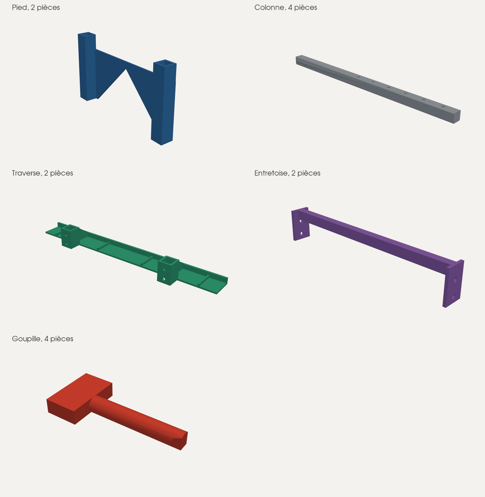

Les fichiers sont déjà positionnés sur le plateau de 256 mm : ne pas utiliser l'arrangement automatique pour la colonne et la traverse. Toutes les pièces s'impriment sans support. La bordure ne concerne que le pied, haut et étroit : la colonne et la traverse laissent trop peu de marge sur le plateau pour en recevoir une. Le tranchage dans Bambu Studio (X1 Carbon, buse 0,4, PETG HF, couche 0,20 mm, 3 parois, remplissage 20 %, 10 % pour les colonnes) donne environ 395 g de filament et 10 h 20 d'impression. Le PETG est préférable au PLA pour sa tenue à l'humidité et à la chaleur des panneaux.

### Montage

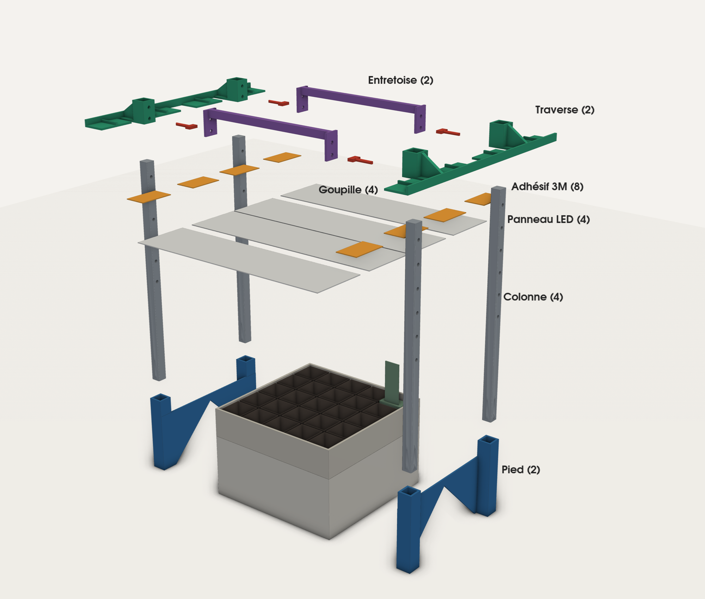

1. Vider et sécher le réservoir, puis poncer légèrement et dégraisser la paroi et le dos des pieds.
2. Coller un pied sur chaque face gauche et droite à la colle époxy bicomposant : pied posé sur la table et centré sur la face, avec le même retrait de 0,3 mm à chaque coin : le pied est un peu moins large que le réservoir. Respecter le temps de durcissement complet. Le bac reste amovible : le dos du pied s'arrête sous le joint avec le réservoir, et les fûts passent à 0,4 mm de sa paroi.
3. Enfoncer les colonnes dans les fûts, la longue partie sans trous vers le bas et la face sans nervure tournée au choix. Leurs nervures d'écrasement suppriment le jeu : elles tiennent en force, sans goupille.
4. Enfiler une traverse sur les deux colonnes de chaque face, la paroi vers l'extérieur, au même cran des deux côtés. Glisser une entretoise entre les coulisseaux en vis-à-vis, à l'avant et à l'arrière, puis bloquer chaque coulisseau avec une goupille, insérée côté bac à travers la patte de l'entretoise et le trou bas du coulisseau.
5. Dégraisser la bande de collage et l'arrière des panneaux à l'alcool isopropylique, puis poser les adhésifs sous la bande, le long de la paroi, chacun dans l'axe d'une nervure.
6. Présenter chaque panneau sous les traverses, LED vers le bas, le bout à 1 mm du bord extérieur de la bande : deux entre les colonnes et un de chaque côté. Presser fermement chaque collage. Le côté de 50 mm de l'adhésif suit la largeur du panneau.
7. Brancher les fiches USB-C sous les panneaux : rien ne les gêne, la traverse restant au-dessus.

Pour déplacer le réservoir, sortir les colonnes en tirant fermement vers le haut. Les pieds restent collés.

| Pied collé sur le réservoir | Coulisseau et goupille, panneaux avant retirés |
|---|---|
| 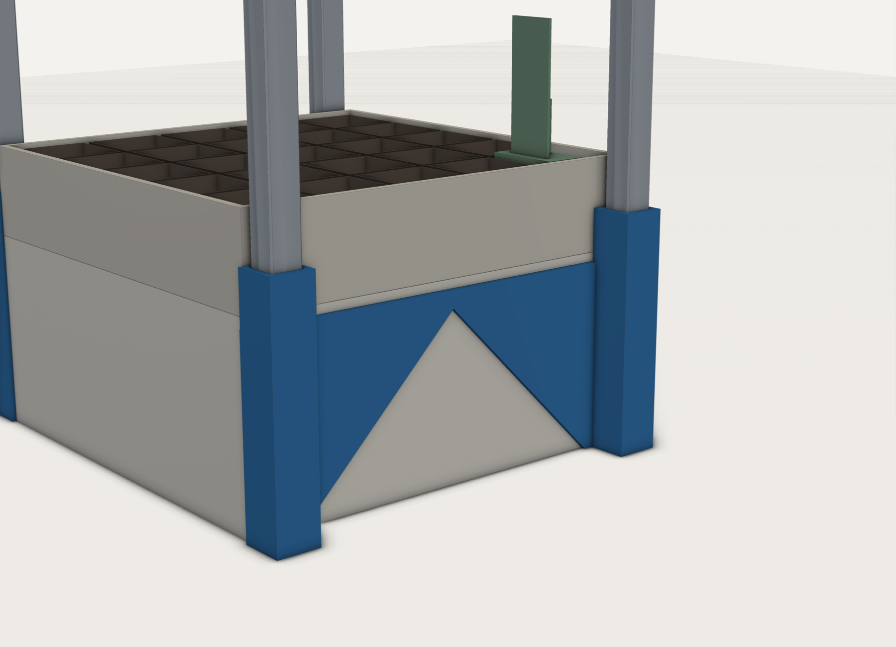 | 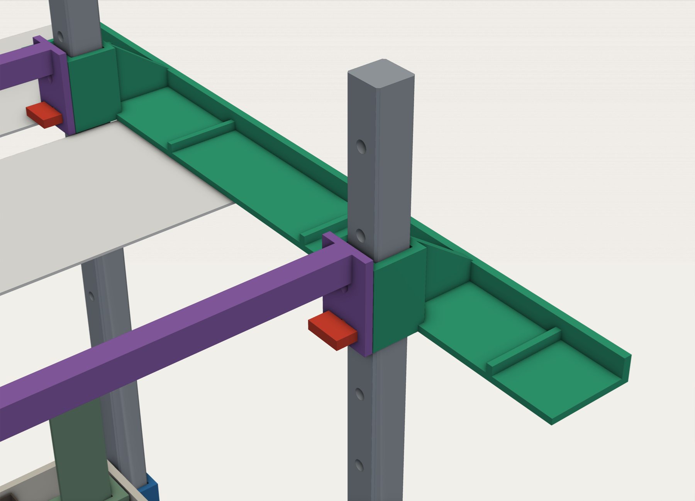 |

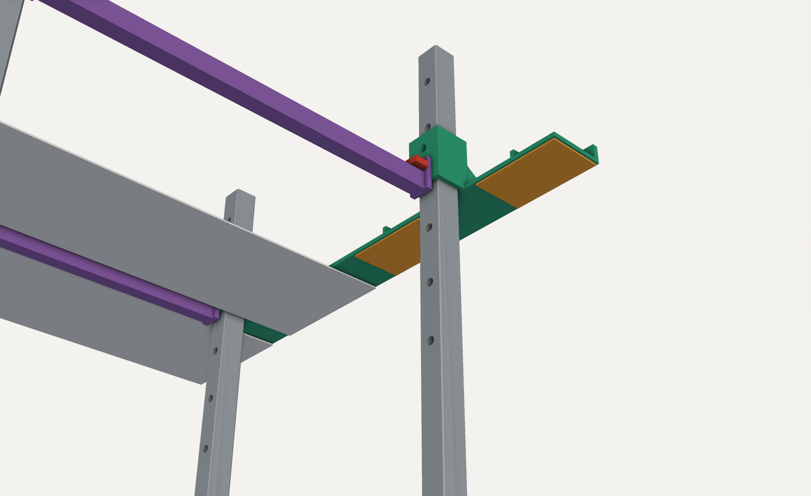

### Réglage de la hauteur

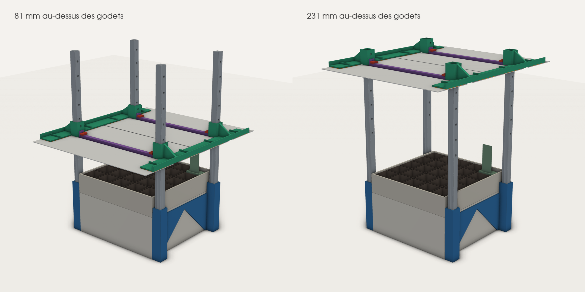

Chaque colonne a 6 trous espacés de 30 mm : le cadre se déplace par crans de 30 mm. La goupille passe toujours par le trou bas du coulisseau, le seul que l'entretoise reprend ; le trou haut ne sert pas. Une fois collés, les panneaux et les traverses forment un seul cadre : retirer les quatre goupilles, soulever le cadre d'un bloc par ses entretoises en le gardant horizontal, puis remettre les goupilles. Ne pas monter un côté avant l'autre, ce qui tordrait les panneaux et décollerait les adhésifs.

- La face LED se règle sur 6 positions, de 211 à 361 mm au-dessus de la table, soit de **81 à 231 mm au-dessus du haut des godets**, pour un adhésif de 1 mm.
- Le cran le plus bas passe 19 mm au-dessus du capteur d'humidité, qui reste le point le plus haut du bac.

### Limites

- Les deux panneaux centraux se touchent presque et couvrent le bac jusqu'à 20 mm de ses bords avant et arrière. Les deux panneaux extérieurs sont presque entièrement en dehors de l'emprise du bac et n'éclairent les semis qu'en biais.
- Sur les panneaux extérieurs, l'adhésif est décalé de 7 mm vers l'intérieur, car la traverse s'arrête à 316 mm pour tenir sur le plateau.
- Les panneaux ne sont tenus qu'à leurs deux bouts, sur 240 mm de portée libre. Selon leur matière, ils peuvent fléchir de quelques millimètres en leur milieu.
- La tenue de l'adhésif dépend de la chaleur des panneaux et de la surface imprimée, et reste à vérifier.

Encombrement : 302 × 357 × 397 mm, et le pied ne dépasse pas la largeur du réservoir. Le script paramétrique [`CAD/support_led.py`](CAD/support_led.py) permet d'ajuster les dimensions : `TAPE_L` et `TAPE_W` pour l'adhésif, `COL` pour la section des colonnes, `FIT` pour le jeu des coulisseaux, `CRUSH` pour le serrage des nervures, `BAR_L` pour la longueur des colonnes. Le script [`CAD/rendu_support_led.py`](CAD/rendu_support_led.py) régénère les images de cette section.

## Licence

Le projet est distribué sous licence Apache 2.0. Consulter le fichier [LICENSE](LICENSE) pour en connaître les conditions.

## Circuit imprimé

Carte simple face de 87 × 55 mm, à graver à la CNC, qui reçoit l'ESP32 DevKit C V4 sur deux barrettes femelles et relie les sondes, les relais et l'alimentation suivant le brochage ci-dessus. L'antenne de l'ESP32 dépasse du bord haut, et le connecteur USB reste accessible en bas.

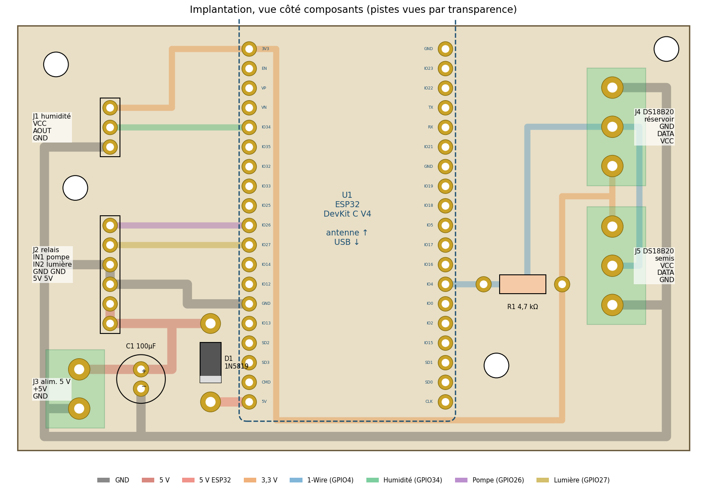

| Repère | Composant | Raccordement |
|---|---|---|
| U1 | ESP32 AZ-Delivery DevKit C V4, sur 2 barrettes femelles 1 × 19 au pas de 2,54 mm | — |
| J1 | Barrette mâle 1 × 3 | Capteur d'humidité : VCC (3V3), AOUT (GPIO34), GND |
| J2 | Barrette mâle 1 × 6 | Relais : IN1 pompe (GPIO26), IN2 lumière (GPIO27), GND, GND, 5V, 5V |
| J3 | Bornier à vis 2 points, pas de 5,08 mm | Alimentation 5 V : +5V, GND |
| J4, J5 | Bornier à vis 3 points, pas de 5,08 mm | DS18B20 réservoir et semis : VCC (3V3), DATA (GPIO4), GND |
| R1 | Résistance 4,7 kΩ 1/4 W | Tirage du bus 1-Wire vers le 3V3 |
| C1 | Condensateur 100 µF 10 V radial, pas de 2,5 mm (facultatif) | Découplage du 5 V |
| D1 | Diode Schottky 1N5819 (1 A, boîtier DO-41), bague vers l'ESP32 | Du bornier 5 V vers la broche 5V de l'ESP32 |

Espacements et perçages, pour vérifier les composants avant d'usiner :

| Repère | Broches | Pas entre broches | Perçage | Pastille de cuivre |
|---|---|---|---|---|
| U1 ESP32 | 2 rangées de 19 | 2,54 mm, rangées espacées de 25,4 mm d'axe en axe | 1,0 mm | 1,9 mm |
| J1 humidité | 1 × 3 | 2,54 mm | 1,0 mm | 1,9 mm |
| J2 relais | 1 × 6 | 2,54 mm | 1,0 mm | 1,9 mm |
| J3 alimentation | 2 | 5,08 mm | 1,3 mm | 2,8 mm |
| J4, J5 DS18B20 | 3 | 5,08 mm | 1,3 mm | 2,8 mm |
| R1 | 2 | 10,16 mm | 1,0 mm | 2,0 mm |
| C1 | 2 | 2,5 mm | 1,0 mm | 2,0 mm |
| D1 | 2 | 10,16 mm | 1,3 mm | 2,6 mm |
| Fixations | 4 trous M3 | Centres à (5 ; 50), (84 ; 52), (7,5 ; 34) et (62 ; 11) mm du coin bas gauche, vue côté composants | 3,2 mm, fraisé | Aucune |

Le script `PCB/pcb_semix.py` (`pip install shapely matplotlib`) vérifie la continuité et l'isolement des réseaux, puis écrit :

- `PCB/fabrication/gerber/` : cuivre face dessous en vue de dessus, contour et perçage Excellon, pour FlatCAM ou un autre logiciel de FAO ;
- `PCB/fabrication/gcode/` : G-code GRBL prêt à l'emploi, déjà mis en miroir pour être usiné côté cuivre, à lancer dans l'ordre :
  1. `1_isolation_fraiseV.nc` : fraise en V (30°, pointe 0,1 mm), 0,1 mm de profondeur, 3 passes ;
  2. `2_percage_1.0mm.nc` et `3_percage_1.3mm.nc` : forets de 1,0 et 1,3 mm ;
  3. `4_detourage_fraise2mm.nc` : fraise droite de 2 mm, trous de fixation M3 puis contour avec 4 attaches.

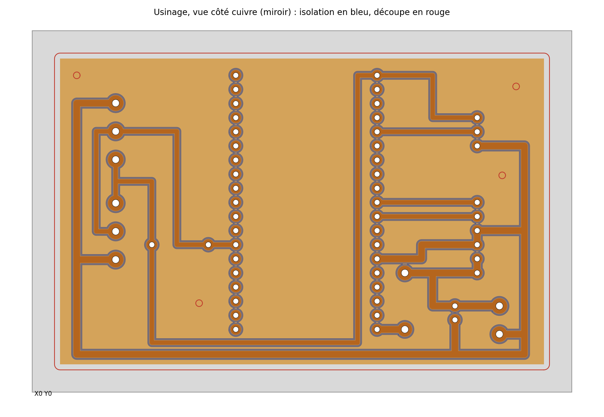

Usinage :

- Plaque FR1 ou FR4 simple face d'au moins 97 × 65 mm, cuivre vers le haut. L'origine X0 Y0 est le coin avant gauche de la plaque, la carte commençant 5 mm plus loin ; Z0 est la surface du cuivre.
- Refaire le zéro Z à chaque changement d'outil, sans toucher à X et Y. Un relevé de planéité (autolevelling, par exemple dans Candle) est fortement conseillé pour l'isolation.
- Avant d'usiner, mesurer l'entraxe des deux rangées de broches de l'ESP32 : la carte suppose 25,4 mm (`ESP_ROW_SPACING` dans le script).

Montage : composants côté sans cuivre, soudures côté cuivre.

L'USB de l'ESP32 peut rester branché pendant que la carte est alimentée par le bornier. D1 empêche le 5 V du bornier de remonter vers l'USB, et la diode que le DevKit C V4 place sur son USB empêche l'inverse : l'ESP32 prend la plus haute des deux tensions. Les relais restent alimentés directement par le bornier : avec l'USB seul, l'ESP32 fonctionne mais les relais ne commutent pas. La chute de tension de D1 laisse environ 4,6 V sur la broche 5V, ce qui suffit au régulateur 3,3 V de l'ESP32. Sur une copie du DevKit d'un autre fabricant, vérifier la présence de la diode USB avant de brancher les deux sources.
