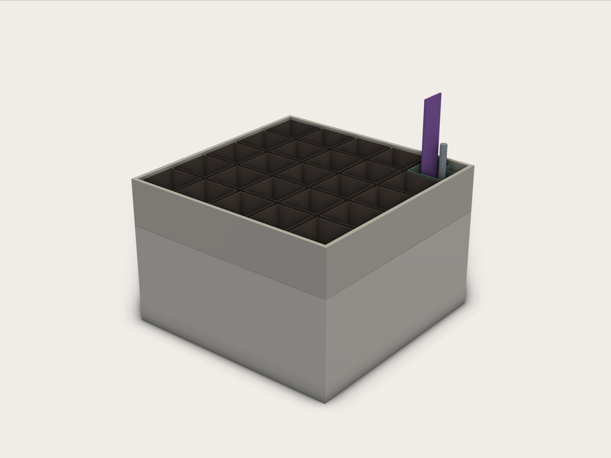
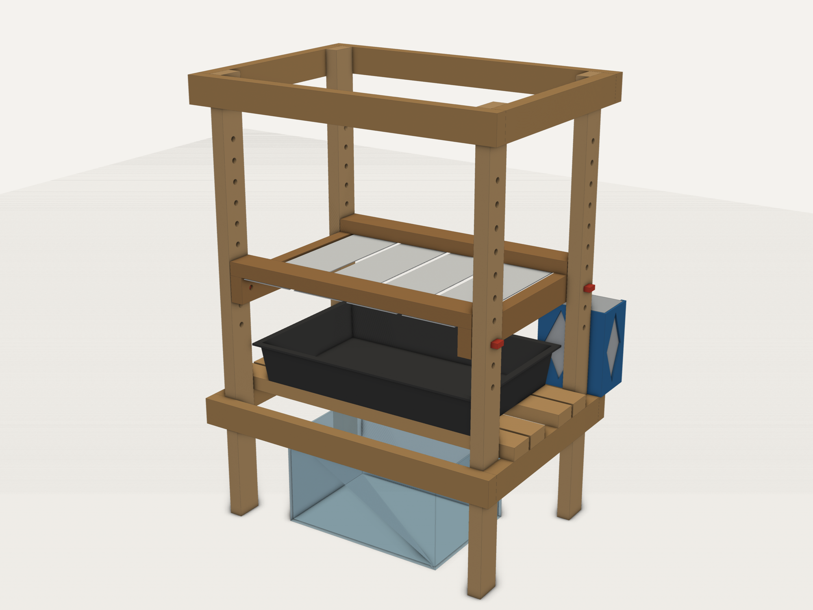

# SemX

SemX est une chambre de culture automatisée pour la germination et les premières semaines des semis. Un ESP32 mesure la température et l'humidité du substrat, puis pilote l'arrosage et l'éclairage. Le tout se règle depuis une page web et peut s'intégrer à une domotique par MQTT.

## Principe

- **Arrosage** : une pompe immergée dans un réservoir d'eau envoie l'eau dans le bac de semis, et un trop-plein renvoie l'excédent dans le réservoir.
- **Mesures** : deux sondes DS18B20 mesurent la température de l'eau du réservoir et celle du semis. Un capteur capacitif mesure l'humidité du substrat.
- **Pilotage** : un relais commande la pompe (cycle temporisé ou selon l'humidité du sol), un autre allume et éteint les panneaux LED à heure fixe.
- **Supervision** : la page web SemX permet de tout régler, et les mesures ainsi que l'état des relais sont publiés sur MQTT.

## Deux versions de la partie mécanique

L'électronique et le firmware sont communs. Seule la partie mécanique, qui porte le bac, le réservoir et les panneaux LED, existe en deux versions.

| [V1 — pièces imprimées](V1/README.md) | [V2 — cadre en bois](V2/README.md) |
|---|---|
|  |  |
| Bac de 201 × 201 mm posé sur le réservoir, 24 godets de semis et un godet de mesure, arrosés par capillarité. Support LED imprimé, collé sur le réservoir. | Bac à semis du commerce (375 × 240 mm) posé sur un cadre en tasseau de 20 × 40 mm. Le réservoir se glisse dessous, et les panneaux LED sont réglables sur 10 hauteurs. |

## Organisation du dépôt

| Dossier | Contenu | Documentation |
|---|---|---|
| [`V1/`](V1/) | Première version de la partie mécanique : fichiers STL à imprimer (réservoir, bac, godets, grille, support LED, boîtier) et scripts Python qui les génèrent (`CAD/`) | [V1/README.md](V1/README.md) |
| [`V2/`](V2/) | Deuxième version de la partie mécanique : cadre en bois pour un bac à semis du commerce, avec réservoir dessous et panneaux LED réglables en hauteur. Scripts de conception (`CAD/`), plan coté des pièces en PDF (`plan_pieces_bois.pdf`), goupille et support du boîtier à imprimer, vues d'assemblage (`STL/`) | [V2/README.md](V2/README.md) |
| [`PlatformIO/`](PlatformIO/) | Firmware de l'ESP32 : mesures, pompe, éclairage, page web, MQTT, OTA | [PlatformIO/README.md](PlatformIO/README.md) |
| [`PCB/`](PCB/) | Circuit imprimé simple face à graver à la CNC : script de génération, Gerber et G-code | [PCB/README.md](PCB/README.md) |

## Matériel et mécanique — [V1/README.md](V1/README.md)

Ce document décrit la version 1 du matériel :

- les [objectifs](V1/README.md#objectifs) de la chambre de culture et les [éléments techniques](V1/README.md#éléments-techniques) (ESP32, capteurs, actionneurs) ;
- le [brochage](V1/README.md#brochage) des capteurs et des relais ;
- le [réservoir, le bac et les godets](V1/README.md#réservoir-bac-et-godets), dont le godet de mesure et la grille sur pieds ;
- le [support des panneaux LED](V1/README.md#support-des-panneaux-led), réglable en hauteur ;
- le [boîtier de l'électronique](V1/README.md#boîtier-de-lélectronique).

## Cadre en bois — [V2/README.md](V2/README.md)

La version 2 remplace le réservoir, le bac et les godets imprimés par un bac à semis du commerce, posé sur un cadre en bois de 475 × 340 × 660 mm. Quatre montants sont reliés par deux ceintures, en bas et en haut. La ceinture basse porte les lattes du porte-bac, et le réservoir passe dessous. Entre les deux ceintures, un cadre lumière porte les quatre panneaux LED de V1 et se règle en hauteur avec des goupilles imprimées. Le boîtier de l'électronique de V1 est debout au coin arrière droit, glissé dans un support imprimé posé sur la ceinture basse et vissé dans le montant.

Ce document décrit :

- le [principe](V2/README.md#principe) et les [éléments du commerce](V2/README.md#éléments-du-commerce) (bac, réservoir, panneaux LED) ;
- la [liste de débit](V2/README.md#liste-de-débit) des 8 pièces en bois numérotées et la quincaillerie, avec le [plan coté](V2/README.md#plan-coté-des-pièces) de chaque pièce, aussi en PDF à imprimer ;
- le [montage](V2/README.md#montage) : [ceintures](V2/README.md#ceintures-basse-et-haute), [porte-bac](V2/README.md#porte-bac), [cadre lumière](V2/README.md#cadre-lumière) et [perçage des montants](V2/README.md#perçage-des-montants) ;
- le [réglage de la hauteur](V2/README.md#réglage-de-la-hauteur) des LED, de 48 à 318 mm au-dessus du bac ;
- les [goupilles imprimées](V2/README.md#goupilles-imprimées) en PETG, le [support du boîtier de l'électronique](V2/README.md#boîtier-de-lélectronique) et l'[arrosage](V2/README.md#arrosage) par la pompe et le trop-plein ;
- les [limites](V2/README.md#limites) connues de cette version.

## Circuit imprimé — [PCB/README.md](PCB/README.md)

Ce document décrit la carte qui reçoit l'ESP32 :

- l'[implantation](PCB/README.md#implantation) des composants, leurs raccordements et leurs perçages ;
- l'[usinage](PCB/README.md#usinage) à la CNC et le [montage](PCB/README.md#montage) ;
- la [régénération](PCB/README.md#régénérer-les-fichiers) des fichiers Gerber, du G-code et des images par le script `pcb_semx.py`.

## Firmware — [PlatformIO/README.md](PlatformIO/README.md)

Ce document décrit le logiciel de l'ESP32 :

- la [compilation et le téléversement](PlatformIO/README.md#compilation-et-téléversement), par USB ou par le réseau (OTA) ;
- le [premier démarrage et la connexion WiFi](PlatformIO/README.md#premier-démarrage-et-connexion-wifi) ;
- le [fonctionnement](PlatformIO/README.md#fonctionnement) des mesures, de la pompe et de l'éclairage ;
- la [page SemX](PlatformIO/README.md#page-semx) et les [topics MQTT](PlatformIO/README.md#mqtt) ;
- les [réglages](PlatformIO/README.md#réglages-et-mémoire) et l'[organisation du code](PlatformIO/README.md#organisation-du-code).

## Pour démarrer

1. Construire la partie mécanique, au choix :
   - V1 : imprimer les pièces de [`V1/STL/`](V1/STL/) (voir [V1/README.md](V1/README.md)) ;
   - V2 : débiter le bois d'après le [plan coté](V2/plan_pieces_bois.pdf), imprimer les goupilles et assembler le cadre (voir [V2/README.md](V2/README.md)).
2. Graver et monter le [circuit imprimé](PCB/README.md), ou câbler l'ESP32 suivant le [brochage](V1/README.md#brochage).
3. Téléverser le firmware avec PlatformIO, puis configurer le WiFi par le point d'accès **SemX-Setup** (voir [PlatformIO/README.md](PlatformIO/README.md)).
4. Régler la pompe, l'éclairage et la calibration de l'humidité sur la page web SemX.
