# SemX V2 — cadre en bois

Deuxième version de la partie mécanique de SemX. Le réservoir, le bac et les godets imprimés de [V1](../V1/README.md) sont remplacés par un bac à semis du commerce, posé sur un cadre en bois. Le réservoir d'eau se glisse sous le bac, et les panneaux LED de V1 sont suspendus au-dessus, à une hauteur réglable. L'électronique, le [circuit imprimé](../PCB/README.md) et le [firmware](../PlatformIO/README.md) ne changent pas.

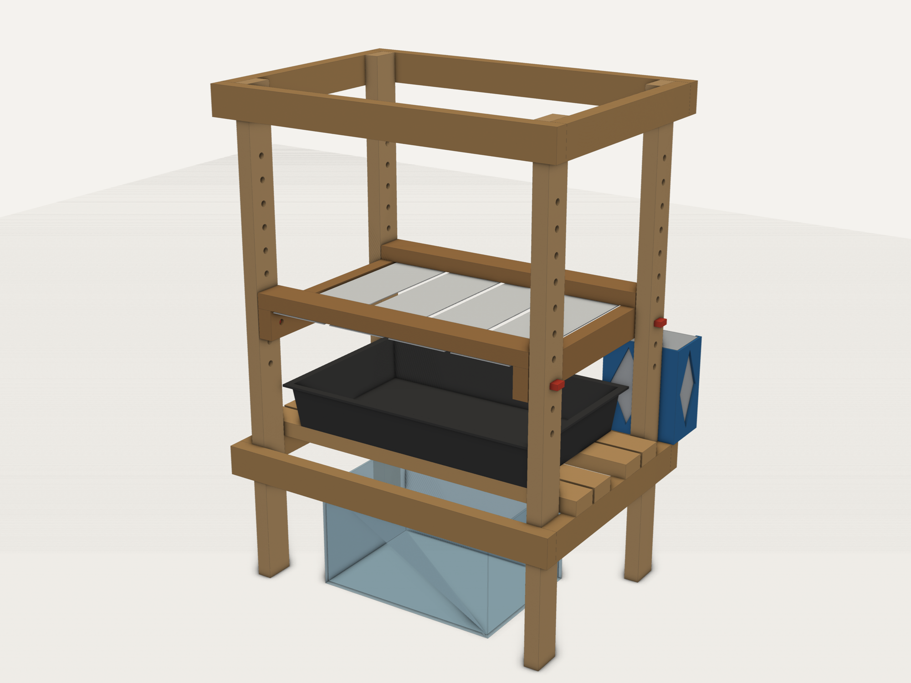

## Principe

- **Quatre montants** en tasseau de 20 × 40 mm servent à la fois de pieds et de colonnes pour l'éclairage.
- **Deux ceintures** en tasseau, vissées autour des montants, les relient entre eux et rendent la structure stable : la ceinture basse, dont le dessous est à 150 mm de la table, et la ceinture haute, au ras du haut des montants.
- **Un porte-bac** de quatre lattes en tasseau, posées à plat sur la ceinture basse, porte le bac, dont le fond est à 210 mm de la table.
- **Le réservoir** passe sous la ceinture basse avant et se glisse sous le bac par l'avant.
- **Le cadre lumière** est fait de deux côtés, dans la largeur, et de deux barres posées dessus, dans la longueur. Les quatre panneaux LED sont collés sous les barres, entre les côtés. Le cadre coulisse entre les montants et repose sur quatre goupilles imprimées en 3D, qui traversent les montants percés tous les 30 mm.
- **Le boîtier de l'électronique** de V1 est debout au coin arrière droit, glissé dans un support imprimé en 3D, posé sur la ceinture basse et vissé dans le montant.

Encombrement : 475 × 340 × 660 mm, ceintures comprises, et 435 × 300 mm entre les ceintures. Avec le boîtier de l'électronique et son support, au coin arrière droit, l'emprise au sol est de 478 × 390 mm. Dans la largeur, l'extérieur des montants est aligné sur la longueur des panneaux LED (300 mm) : les bouts des panneaux, des barres et des côtés du cadre lumière arrivent au ras des montants. Toutes les pièces de bois sont taillées dans du tasseau raboté de 20 × 40 mm.

## Éléments du commerce

| Élément | Dimensions | Remarque |
|---|---|---|
| Bac à semis en plastique | Intérieur : 340 × 205 mm au fond, 355 × 220 mm en haut. Extérieur en haut, rebord compris : 375 × 240 mm. Hauteur : 60 mm | Posé à plat sur les lattes du porte-bac |
| Réservoir d'eau | 255 × 184 × 140 mm | Reçoit la pompe immergée |
| Panneaux LED (ceux de V1) | 4 panneaux de 300 × 80 × 1 mm | Collés avec 8 adhésifs double face 3M de 30 × 50 mm |
| Boîtier de l'électronique (celui de V1) | 100 × 125 × 61,4 mm, couvercle compris : 62,8 mm | Imprimé à partir de [`V1/STL/`](../V1/STL/), voir [V1](../V1/README.md#boîtier-de-lélectronique) |

Le modèle suppose une paroi de 2 mm et un rebord plat de 3 mm pour le bac : seules les cotes mesurées comptent pour le cadre.

## Liste de débit

| Repère | Pièce | Quantité | Matériau | Longueur | Usinage |
|---|---|---|---|---|---|
| 1 | Montant | 4 | Tasseau raboté 20 × 40 mm | 660 mm | 10 trous Ø 8 traversant les 20 mm, voir [Perçage des montants](#perçage-des-montants) |
| 2 | Ceinture basse latérale | 2 | Tasseau raboté 20 × 40 mm | 300 mm | Posée sur chant, contre l'extérieur des montants |
| 3 | Ceinture basse avant ou arrière | 2 | Tasseau raboté 20 × 40 mm | 475 mm | Posée sur chant, contre l'extérieur des montants |
| 4 | Latte du porte-bac | 4 | Tasseau raboté 20 × 40 mm | 475 mm | Posée à plat sur les ceintures basses latérales |
| 5 | Côté du cadre lumière | 2 | Tasseau raboté 20 × 40 mm | 300 mm | Posé sur chant ; 2 trous Ø 8 traversant les 20 mm, à 20 mm de chaque bout et à mi-hauteur |
| 6 | Barre du cadre lumière | 2 | Tasseau raboté 20 × 40 mm | 393 mm | Posée à plat sur les côtés |
| 7 | Ceinture haute avant ou arrière | 2 | Tasseau raboté 20 × 40 mm | 475 mm | Posée sur chant, contre l'extérieur des montants |
| 8 | Ceinture haute latérale | 2 | Tasseau raboté 20 × 40 mm | 300 mm | Posée sur chant, contre l'extérieur des montants |

Soit 9,03 m de tasseau, qui se débitent dans cinq longueurs de 2 m (660 + 660 + 660, 660 + 475 + 475 + 300, 475 + 475 + 475 + 475, 475 + 475 + 393 + 393, 300 + 300 + 300 + 300 + 300), en comptant 3 mm par trait de scie. Le pin ou le sapin conviennent. Une finition à l'huile ou au vernis, surtout sur les lattes du porte-bac, résiste mieux à l'humidité du bac.

Les goupilles sont imprimées : voir [Goupilles imprimées](#goupilles-imprimées).

Quincaillerie : 64 vis à bois 4 × 40 mm (24 par ceinture, 8 pour les lattes du porte-bac, 8 pour le cadre lumière), et de la colle à bois. Pour le support du boîtier de l'électronique : 2 à 4 vis à bois à tête fraisée 4 × 25 mm.

Orientation des tasseaux :

- **Montants** : face de 40 mm vers la gauche et la droite. Les trous Ø 8 traversent les 20 mm et laissent 16 mm de bois de chaque côté, et les 40 mm raidissent la structure dans le sens avant-arrière.
- **Ceintures et côtés du cadre lumière** : sur chant, 40 mm de haut, pour ne pas fléchir.
- **Lattes du porte-bac** : à plat, 40 mm de large, pour porter le fond du bac.
- **Barres du cadre lumière** : à plat, 40 mm de large, posées sur les côtés, pour recevoir les adhésifs de 30 mm sous les panneaux.

### Plan coté des pièces

Chaque pièce est dessinée vue sur sa face de 40 mm, avec sa longueur, ses perçages, ses vis et l'emplacement des pièces qui s'y fixent : hachures bleues ou orange pour une pièce vissée contre la face, bande verte numérotée pour une pièce posée sur le dessus (par exemple les lattes 4 sur les ceintures basses latérales 2, ou les barres 6 sur les côtés 5). Les cotes partent du bout gauche de la pièce. Une version à imprimer pour l'atelier est dans [`plan_pieces_bois.pdf`](plan_pieces_bois.pdf).

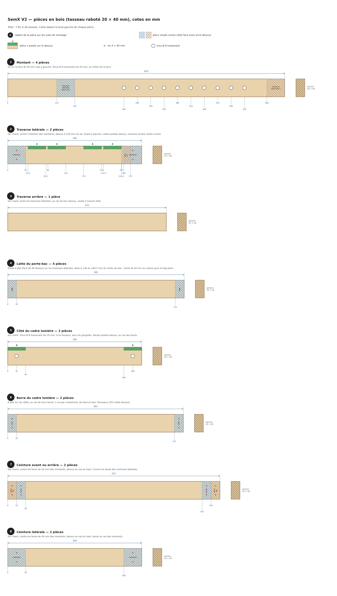

## Montage

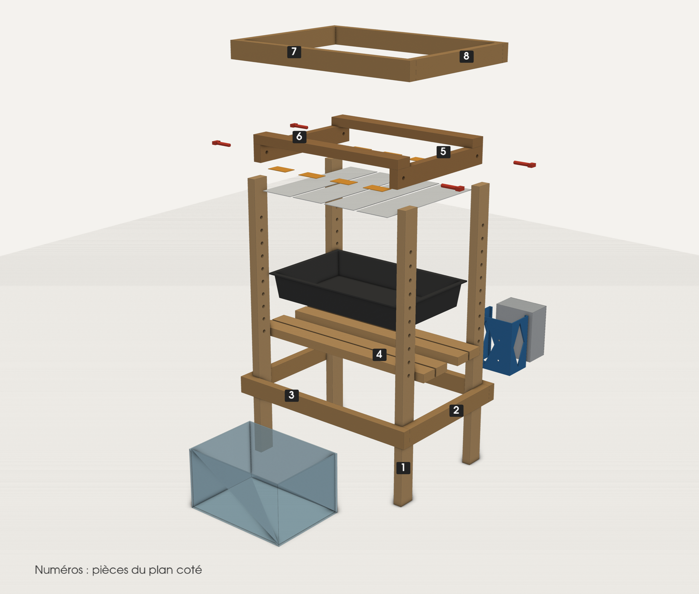

Les numéros renvoient à la liste de débit et au [plan coté](#plan-coté-des-pièces). De bas en haut : montants et ceinture basse, réservoir (sorti vers l'avant), lattes du porte-bac (soulevées), bac, panneaux et adhésifs, cadre lumière et goupilles, ceinture haute (soulevée).

### Ceintures basse et haute

Les deux ceintures entourent les quatre montants, vissées contre leurs faces extérieures. Elles se montent de la même façon : seule leur hauteur change. Avec elles, chaque côté et chaque face de la structure forment un rectangle fermé, ce qui l'empêche de se déformer en parallélogramme.

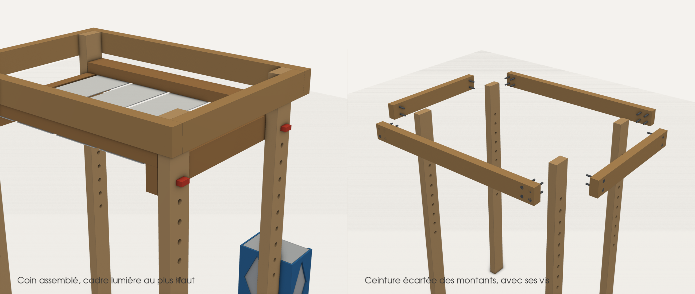

- **Ceintures latérales** (2 en bas, 8 en haut ; 300 mm) : sur chant, contre les faces extérieures de 40 mm des montants, au ras de leurs bouts avant et arrière.
- **Ceintures avant et arrière** (3 en bas, 7 en haut ; 475 mm) : sur chant, contre les faces extérieures de 20 mm des montants. Elles débordent de 20 mm de chaque côté pour couvrir les bouts des ceintures latérales.
- **Hauteurs** : le dessous de la ceinture basse est à 150 mm du bas des montants, le dessus de la ceinture haute au ras du haut des montants.

1. Percer les montants (1) avant tout assemblage : voir [Perçage des montants](#perçage-des-montants).
2. Visser chaque ceinture latérale, basse (2) puis haute (8), contre deux montants : deux vis 4 × 40 mm par montant, l'une au-dessus de l'autre, et de la colle. Vérifier l'équerre entre la ceinture et les montants. Les trous des montants doivent se trouver sur les faces de 40 mm, celles qui reçoivent les ceintures latérales.
3. Visser les ceintures avant et arrière, basses (3) puis hautes (7) : deux vis 4 × 40 mm dans chaque montant, et deux dans le bout de chaque ceinture latérale, toujours avec de la colle. Faire des avant-trous de Ø 2,5 mm, surtout dans les bouts des ceintures latérales, à 10 mm du bord.
4. Avant que la colle prenne, vérifier que la structure est d'équerre en mesurant les diagonales du dessus et de chaque côté, qui doivent être égales deux à deux.

Il faut 24 vis par ceinture : 8 par ceinture avant ou arrière et 4 par ceinture latérale. Elles traversent les 20 mm de la pièce et entrent de 20 mm dans le bois.

### Porte-bac

Poser les quatre lattes du porte-bac (4), à plat, sur les ceintures basses latérales (2), au ras de leur face extérieure. Les lattes passent entre les montants avant et arrière, avec 5,5 mm de jeu. Leurs axes sont à 40 et 84,5 mm de part et d'autre du milieu : les deux lattes extérieures arrivent au bord du fond du bac (209 mm), et les deux du milieu laissent entre elles une fente de 40 mm pour le trop-plein. Il reste 4,5 mm entre une latte du milieu et sa voisine. Visser chaque latte dans les ceintures, une vis 4 × 40 mm à chaque bout, après un avant-trou.

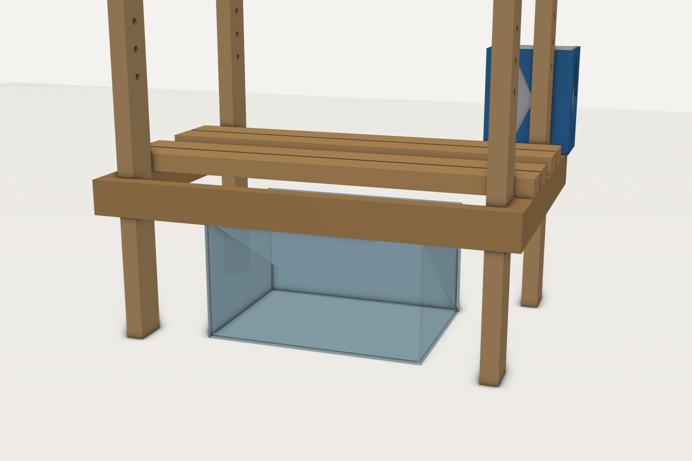

Le réservoir passe sous la ceinture basse avant, avec 10 mm de marge en hauteur, et se glisse sous le bac. Il reste 70 mm de chaque côté entre le réservoir et les montants.

Le cadre lumière reste à l'intérieur des montants : la ceinture haute ne le gêne pas, et au plus haut, son dessus reste 10 mm sous elle. Les goupilles du trou le plus haut passent 46 mm sous la ceinture haute et se saisissent facilement.

### Cadre lumière

1. Poser les deux barres (6), à plat, sur les deux côtés (5) posés sur chant, au ras des bouts des côtés et de leur face extérieure : leurs bords extérieurs sont alors à 300 mm l'un de l'autre, la longueur des panneaux. Deux vis 4 × 40 mm par croisement, de haut en bas à travers la barre, et de la colle. Vérifier l'équerrage avant que la colle prenne.
2. Vérifier que le cadre entre entre les montants avec environ 1 mm de jeu de chaque côté. Il se met en place par l'avant, en le glissant à plat entre les deux montants avant (393 mm de large pour 395 mm de passage), entre les deux ceintures.
3. Dégraisser le dessous des barres et le dos des panneaux à l'alcool isopropylique. Coller un adhésif à chaque bout de panneau, puis les panneaux sous les barres, LED vers le bas, dans le sens avant-arrière, avec 8 mm d'écart entre deux panneaux. Les panneaux se logent entre les côtés, avec 4,5 mm de jeu de chaque côté.

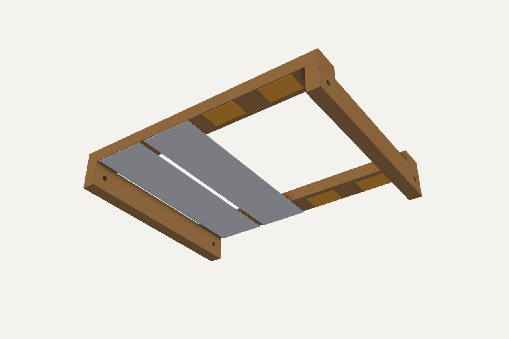

Les quatre panneaux couvrent 344 mm sur les 355 mm de longueur intérieure du bac, et 300 mm sur ses 220 mm de largeur : les bouts des panneaux dépassent de 40 mm à l'avant et à l'arrière.

### Réglage de la hauteur

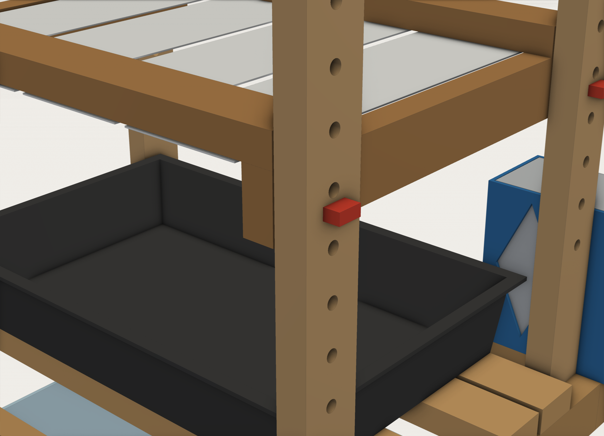

Chaque goupille traverse le montant, de l'extérieur vers l'intérieur, et entre de 17 mm dans le côté du cadre lumière, épais de 20 mm. Sa poignée reste à l'extérieur, en butée contre le montant. Pour changer de hauteur : tenir le cadre, retirer les quatre goupilles par leur poignée, déplacer le cadre en le gardant horizontal, puis remettre les goupilles dans les trous de même hauteur.

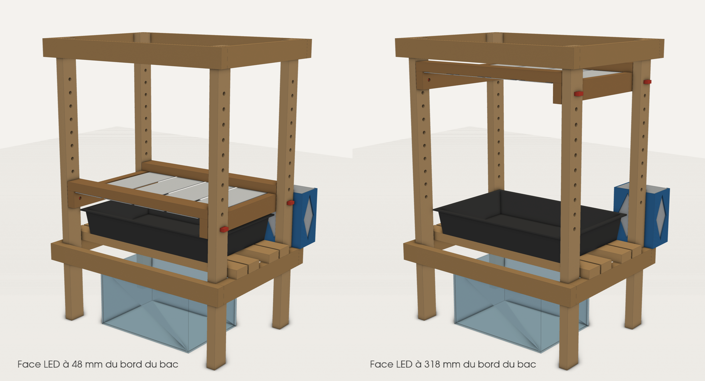

La face LED se règle sur 10 positions, de **48 à 318 mm au-dessus du bord du bac**, tous les 30 mm. Au plus bas, le dessous des côtés du cadre passe 10 mm au-dessus du rebord du bac.

### Perçage des montants

Chaque montant reçoit 10 trous Ø 8, qui traversent ses 20 mm de la face intérieure vers la face extérieure (axe gauche-droite), au milieu de la face de 40 mm. Hauteurs des axes depuis le bas du montant :

300, 330, 360, 390, 420, 450, 480, 510, 540 et 570 mm.

Percer les quatre montants ensemble, serrés côte à côte par leurs faces de 40 mm, ou au moins avec un gabarit, pour que les trous soient à la même hauteur sur tous. Utiliser une perceuse à colonne ou un guide de perçage, et une planche martyre pour éviter les éclats en sortie.

## Goupilles imprimées

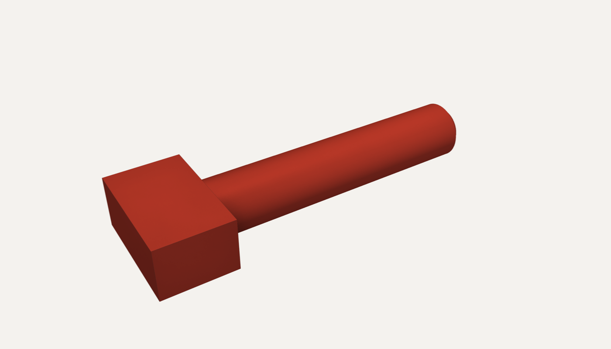

Les quatre goupilles qui tiennent le cadre lumière s'impriment à partir de [`STL/goupille_cadre_lumiere.stl`](STL/goupille_cadre_lumiere.stl). Imprimer 4 goupilles, plus 1 de rechange.

- **Tige** : Ø 7,7 mm, soit 0,15 mm de jeu par côté dans les trous de Ø 8. Elle mesure 38 mm sous la poignée : 20 mm dans le montant, 1 mm de jeu, puis 17 mm dans le côté du cadre lumière. Sa pointe est chanfreinée de 1 mm pour entrer facilement.
- **Méplat** de 0,5 mm sous toute la longueur : la goupille s'imprime couchée, couches dans le sens de la tige, ce qui la rend bien plus résistante au cisaillement qu'une goupille imprimée debout.
- **Poignée** de 10 × 16 mm, de la même épaisseur que la tige (7,2 mm). Elle sert à saisir la goupille et fait butée contre le montant, car elle est plus large que le trou.

Encombrement : 48 × 16 × 7,2 mm, environ 3,6 g de PETG par goupille.

Impression (Bambu Studio, imprimante Bambu Lab avec buse de 0,4 mm) :

1. Importer le STL tel quel : il est déjà posé sur son méplat. Ne pas le faire pivoter.
2. Faire 5 copies, par exemple avec un clic droit puis « Cloner ».
3. Choisir le PETG, préférable au PLA pour sa tenue à l'humidité et à la chaleur des panneaux, comme pour V1. Couches de 0,20 mm, 4 parois et remplissage de 100 % : la pièce est petite, autant la faire pleine.
4. Aucun support ni bordure n'est nécessaire.

Essayer une goupille dans un trou avant d'imprimer les autres. Le diamètre réel d'un trou percé dans le bois varie selon le foret et l'essence : si la goupille force, réduire `PIN_D` de 0,1 ou 0,2 mm ; si elle a trop de jeu, l'augmenter, puis relancer le script.

## Boîtier de l'électronique

Le boîtier de V1 est debout au coin arrière droit de la structure, derrière le montant, posé sur la ceinture basse. Il se glisse par le haut dans un support imprimé, sans vis. Cet emplacement :

- est hors de l'emprise du bac (30 mm derrière son rebord) : l'eau qui coulerait du bac ne tombe pas dessus ;
- laisse libre l'avant, par où passe le réservoir, et les goupilles du montant arrière droit, dont les poignées passent 12 mm devant le support ;
- est proche du réservoir et de la pompe, et à mi-chemin des capteurs du bac et des panneaux LED.

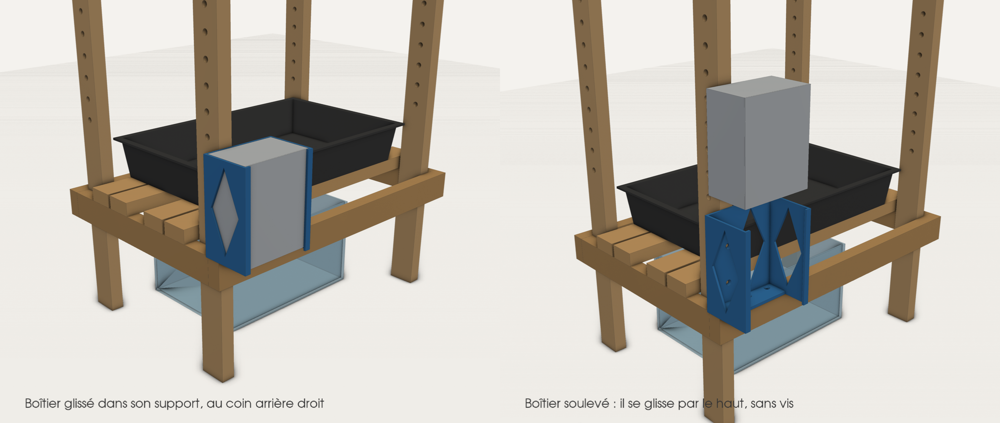

Le boîtier est debout, sa longueur de 125 mm à la verticale, de 194 à 319 mm du sol : son dessus est 49 mm au-dessus du haut du bac. Son côté droit arrive au ras du côté droit de la structure, son fond est contre le support et son couvercle vers l'arrière. L'encoche des câbles se trouve dans la paroi du bas, près du couvercle : les câbles entrent par-dessous, et l'eau qui coulerait le long d'un câble ne peut pas entrer dans le boîtier.

### Support à glissière

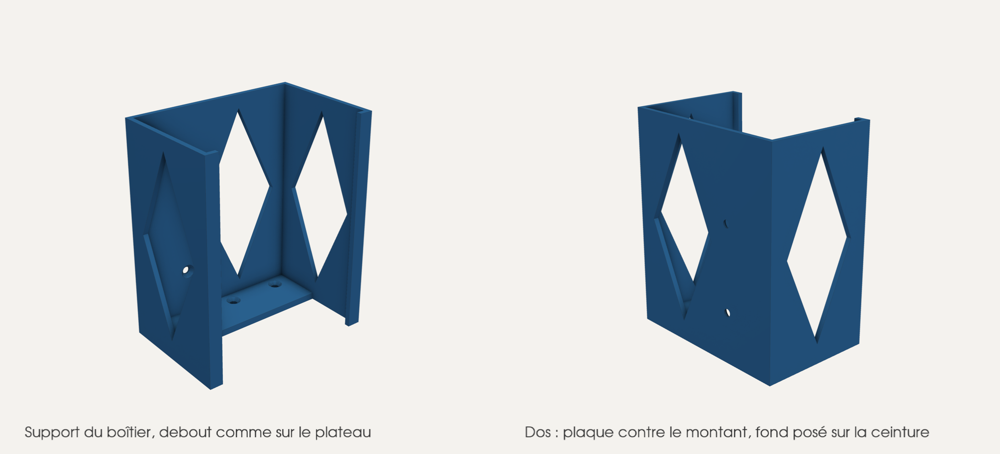

Le support, [`STL/support_boitier.stl`](STL/support_boitier.stl), est un U en PETG de 3 mm d'épaisseur, de 107 × 70 × 129 mm, qui enveloppe le boîtier sur trois côtés. Il est posé sur le dessus de la ceinture basse arrière (3) et vissé dans le dos du montant arrière droit :

- **une plaque** contre le dos du montant arrière droit, vissée dedans par deux vis à bois 4 × 25 mm, à 220 et 270 mm du sol, sous le trou de goupille le plus bas ;
- **deux joues** le long des côtés du boîtier, terminées par **des lèvres** de 5 mm qui passent devant les bords du couvercle et retiennent le boîtier vers l'arrière ;
- **un fond** posé sur le dessus de la ceinture basse arrière, sur lequel le boîtier repose. Il porte le poids du boîtier sur la ceinture, et peut y être vissé par deux vis à bois 4 × 25 mm, verticales, au milieu de l'épaisseur de la ceinture. Il ne fait que 33 mm de profondeur et laisse l'encoche des câbles libre ;
- **des fenêtres en losange** qui allègent la plaque, à gauche des vis du montant, et les joues.

Le boîtier a 0,5 mm de jeu de chaque côté dans la glissière. Il se glisse par le haut, et il en sort de la même façon pour ouvrir le couvercle : les lèvres empêchent de retirer le couvercle tant que le boîtier est en place.

Impression (Bambu Studio, buse de 0,4 mm) : importer le STL tel quel, il est déjà debout, posé sur son fond et le bas de ses parois. Toutes les parois sont verticales et les fenêtres en losange se ferment en pointe : aucun support n'est nécessaire. PETG, couches de 0,20 mm, 3 parois, remplissage de 25 %. Au plus 108 g de filament.

### Montage

1. Poser le support sur la ceinture basse arrière (3), au coin arrière droit, la plaque contre le dos du montant et la joue droite au ras du côté droit de la structure.
2. Le visser dans le montant avec deux vis à bois 4 × 25 mm, après des avant-trous, par les trous fraisés de la plaque.
3. Si on le souhaite, le visser aussi dans le dessus de la ceinture avec deux vis à bois 4 × 25 mm, par les trous fraisés du fond. Ces vis sont à au moins 28 mm des vis de la ceinture. Toutes les vis du support sont derrière le boîtier : on y accède en sortant le boîtier par le haut.
4. Installer l'électronique dans le boîtier, faire passer les câbles par l'encoche du bas, puis emboîter le couvercle.
5. Glisser le boîtier par le haut dans le support, couvercle vers l'arrière, jusqu'au fond.

## Arrosage

Le principe de V1 reste valable : la pompe du réservoir envoie l'eau dans le bac, et un trop-plein en renvoie l'excédent dans le réservoir.

- **Trop-plein** : percer le fond du bac au-dessus de la fente centrale du porte-bac, à 110 mm à gauche du milieu, et y monter un passe-cloison avec un tube vertical, dont la hauteur fixe le niveau d'eau. L'écrou du passe-cloison (30 mm au plus) loge dans la fente de 40 mm, et l'eau retombe directement dans le réservoir.
- **Pompe** : le tuyau monte par l'avant, ouvert, et entre dans le bac par-dessus le rebord.

Le passe-cloison et le tube ne sont pas dessinés. La position du trop-plein se règle avec `DRAIN_XY` dans le script : il doit rester dans la fente, au-dessus du réservoir et sous le fond du bac, ce que le script contrôle.

## Fichiers

| Fichier | Rôle |
|---|---|
| [`CAD/cadre_bois.py`](CAD/cadre_bois.py) | Script paramétrique : affiche la liste de débit, contrôle les jeux (réservoir, trop-plein, panneaux, cadre lumière, goupilles) et écrit dans `STL/` la goupille et les vues d'assemblage |
| [`CAD/rendu_cadre.py`](CAD/rendu_cadre.py) | Régénère les images de ce document dans `CAD/images/` |
| [`CAD/plan_pieces.py`](CAD/plan_pieces.py) | Régénère le plan coté des pièces : `CAD/images/cadre_pieces_cotes.png` et `plan_pieces_bois.pdf` |
| `STL/goupille_cadre_lumiere.stl` | Goupille à imprimer, déjà posée sur son méplat |
| `STL/support_boitier.stl` | Support à glissière du boîtier de l'électronique à imprimer, déjà debout |
| `STL/assemblage_v2_vue.stl`, `STL/assemblage_v2_eclate_vue.stl` | Vues d'assemblage, montée et éclatée, non destinées à l'impression |

```bash
pip install numpy trimesh manifold3d pyvista pillow matplotlib
```

```bash
python V2/CAD/cadre_bois.py && python V2/CAD/rendu_cadre.py && python V2/CAD/plan_pieces.py
```

Principaux réglages, en tête de `cadre_bois.py` :

| Réglage | Valeur | Rôle |
|---|---|---|
| `TW`, `TL` | 20 × 40 mm | Section des tasseaux |
| `CLEAR_UNDER` | 150 mm | Hauteur libre sous la ceinture basse, pour le passage du réservoir |
| `DRAIN_GAP` | 40 mm | Fente entre les deux lattes du milieu du porte-bac |
| `BAC_CLEAR` | 10 / 5 mm | Jeu autour du rebord du bac : contre les montants en longueur, jusqu'aux lattes en largeur |
| `LEG_H` | 660 mm | Hauteur des montants |
| `FRAME_Z`, `HOLE_PITCH` | 280 à 550 mm, 30 mm | Positions du dessous des côtés du cadre lumière |
| `PANEL_GAP` | 8 mm | Écart entre deux panneaux |
| `PIN_D`, `PIN_L` | Ø 7,7 mm, 38 mm | Diamètre et longueur sous la poignée de la goupille, pour des trous de Ø 8 (`HOLE_D`) |
| `DRAIN_XY`, `DRAIN_D` | (−110 ; 0), Ø 30 mm | Position et encombrement du passe-cloison du trop-plein |

## Limites

- Les cotes du bac sont celles mesurées. Son épaisseur de paroi et la forme de son rebord sont supposées, sans effet sur le cadre.
- Le réservoir ne passe sous la ceinture basse avant qu'avec 10 mm de marge : un réservoir plus haut, ou posé sur un support, demande d'augmenter `CLEAR_UNDER`, ce qui rehausse toute la structure.
- Le fond du bac repose sur les lattes, sauf au droit de la fente centrale de 40 mm. Un fond très souple peut s'y creuser légèrement sous le poids du terreau mouillé : réduire `DRAIN_GAP` si nécessaire, sans descendre sous l'encombrement du passe-cloison.
- Les panneaux ne sont tenus qu'à leurs deux bouts, sur 236 mm de portée libre entre les adhésifs, comme dans V1.
- Au plus bas (trou à 300 mm), l'arrière du cadre lumière arrive au ras de la plaque du support du boîtier, sans jeu : le cadre se glisse par l'avant et vient en butée contre elle.
- Le support du boîtier n'a pas été imprimé ni essayé : le jeu de 0,5 mm par côté dans la glissière dépend de la précision de l'impression, du boîtier comme du support. Si le boîtier force, augmenter `BRK_CLEAR` dans le script ; s'il bouge trop, le diminuer.
